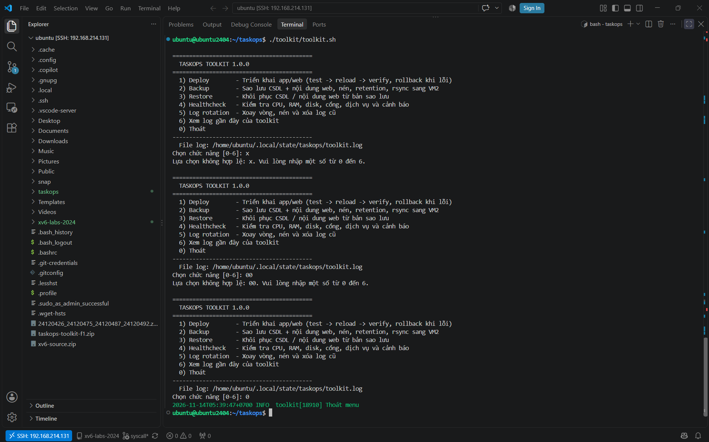
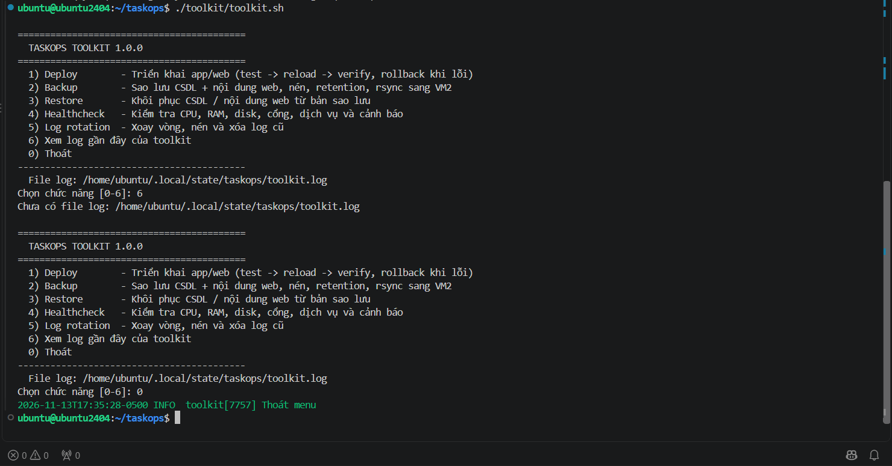
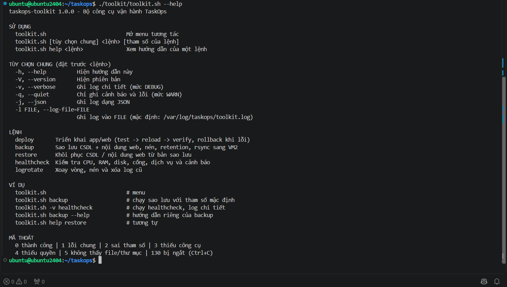
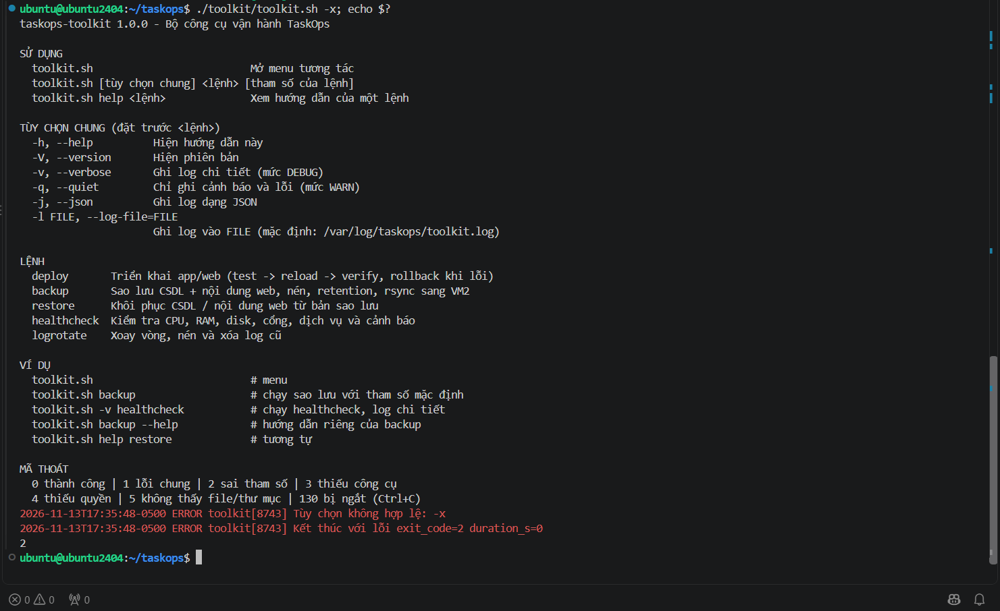
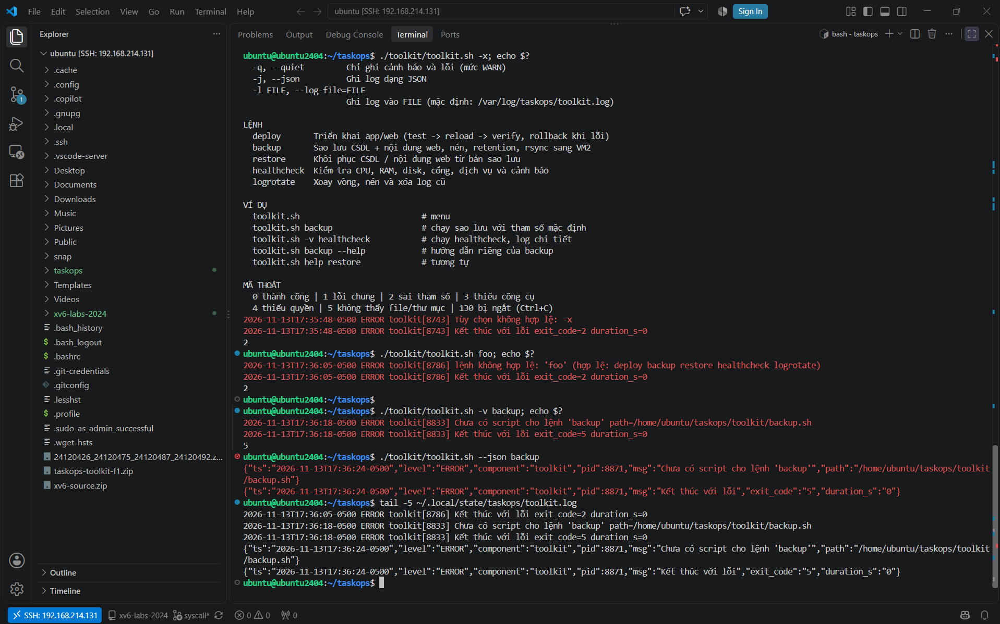
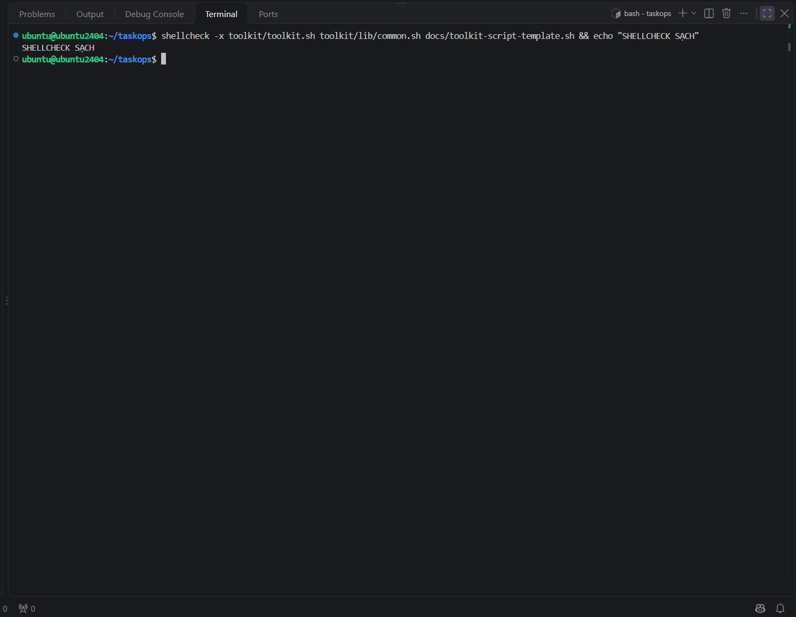
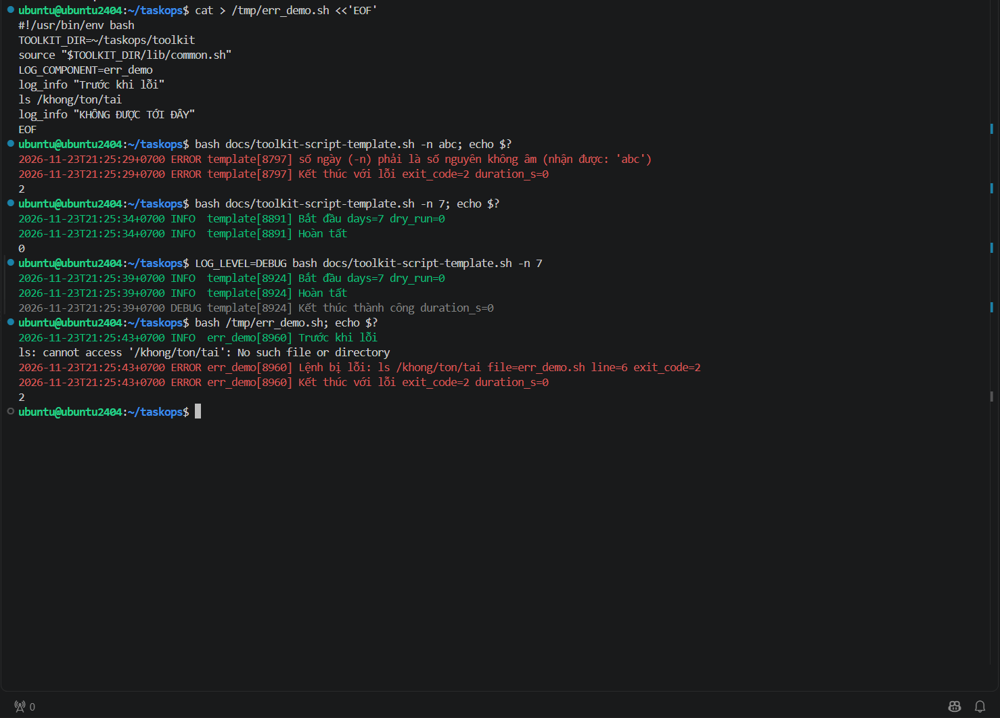

# F01–F05: Toolkit Core (Bash)

Người thực hiện: Nguyễn Tấn Vinh  ·  Ngày: 22/11/2026

Mã nguồn: `toolkit/toolkit.sh`, `toolkit/lib/common.sh`; mẫu cho script con: `docs/toolkit-script-template.sh`
Môi trường thử nghiệm: Ubuntu 24.04, ShellCheck 0.9.0. Mọi lệnh bên dưới chạy từ thư mục gốc của repo (`~/taskops`).
Cấu trúc theo `toolkit/README.md`: `toolkit.sh` chỉ điều phối (dispatch), `lib/common.sh` chứa strict mode, logging, trap, die, confirm; các công cụ con nằm trong `toolkit/bin/`.

| Task | Nội dung | Điểm |
|---|---|---|
| F01 | Cấu trúc thư mục, entry point, menu tương tác | 1.0 |
| F02 | `--help` và hướng dẫn sử dụng | 0.5 |
| F03 | Xử lý tham số bằng `getopts` | 2.0 |
| F04 | Structured logging | 2.0 |
| F05 | Input validation và error handling | 2.0 |

---

## F01 – Cấu trúc thư mục, entry point và menu tương tác

**Tại sao cần:** Đề bài yêu cầu một menu CLI làm điểm vào, điều phối tới deploy, backup, restore, healthcheck, logrotate và xử lý được nhập sai. Một entry point duy nhất giúp người vận hành không phải nhớ đường dẫn từng script, và các script của các thành viên khác cùng dùng chung `lib/common.sh`.

**Đã làm:**
- `toolkit/toolkit.sh` là entry point, chỉ điều phối: đọc tùy chọn, rồi mở menu hoặc chạy công cụ trong `toolkit/bin/<lệnh>.sh`.
- Menu 0–6. Nhập sai thì báo lỗi và hỏi lại; Enter hiện lại menu; Ctrl+D thoát gọn.
- Một công cụ lỗi hoặc chưa có script thì quay lại menu, không làm thoát cả toolkit.
- Tham số bổ sung nhập ở menu được kiểm tra ký tự (chỉ chữ, số và `_ . / = : , @ -`) trước khi chuyền xuống công cụ.

**Cách kiểm chứng:**
```
./toolkit/toolkit.sh      # nhập: x, 00, 6, 0
```

**Bằng chứng:**

Menu báo lỗi khi nhập sai (`x`, `00`), hiện lại menu, nhập `0` thì thoát:



Menu mục 6 (xem log gần đây); khi chưa có file log thì báo rõ đường dẫn:



---

## F02 – `--help` và hướng dẫn sử dụng

**Tại sao cần:** Đề bài yêu cầu mỗi công cụ có output `--help`. Người dùng mới và người chấm cần biết cú pháp, tùy chọn, ví dụ và mã thoát mà không phải đọc mã nguồn.

**Đã làm:** `toolkit.sh -h|--help` liệt kê cách dùng, tùy chọn chung, danh sách lệnh, ví dụ và bảng mã thoát. `toolkit.sh help <lệnh>` và `toolkit.sh <lệnh> --help` chuyển sang hướng dẫn riêng của công cụ con. `docs/toolkit-script-template.sh` có sẵn hàm `usage()` để các script khác làm theo.

**Cách kiểm chứng:**
```
./toolkit/toolkit.sh --help
```

**Bằng chứng:**



---

## F03 – Xử lý tham số bằng `getopts`

**Tại sao cần:** `getopts` là cách chuẩn của Bash để đọc tùy chọn: tự xử lý `-n 7` hay `-n7`, báo lỗi khi sai tùy chọn hoặc thiếu giá trị. Tự cắt chuỗi bằng `$1 $2` dễ sai và khó mở rộng khi thêm tùy chọn.

**Đã làm:**
- `toolkit.sh` dùng `getopts ':hVvqjl:'` cho tùy chọn chung: `-h`, `-V`, `-v` (log DEBUG), `-q` (chỉ WARN trở lên), `-j` (log JSON), `-l FILE` (file log).
- `getopts` chỉ hiểu tùy chọn ngắn, nên hàm `translate_long_opts` đổi `--help`, `--version`, `--verbose`, `--quiet`, `--json`, `--log-file=FILE` đứng **trước** tên lệnh sang dạng ngắn. Tham số đứng sau tên lệnh giữ nguyên để công cụ con tự xử lý (ví dụ `backup --help` đi thẳng tới `bin/backup.sh`).
- Chế độ silent (dấu `:` ở đầu chuỗi `getopts`) để tự báo lỗi bằng tiếng Việt kèm mã thoát 2.
- Cấu hình log (`-v`, `-q`, `-j`, `-l`) được `export` xuống các công cụ con.

**Cách kiểm chứng:**
```
./toolkit/toolkit.sh -x; echo $?       # tùy chọn sai -> in hướng dẫn, mã thoát 2
./toolkit/toolkit.sh --json backup     # đổi định dạng log sang JSON
```

**Bằng chứng:**

Tùy chọn sai `-x`: báo lỗi và mã thoát 2:



Tùy chọn `--json` cho log dạng JSON (xem ảnh ở mục F04).

---

## F04 – Structured logging

**Tại sao cần:** Các script deploy, backup, healthcheck chạy tự động (systemd timer 02:00). Khi có sự cố phải tra log được ngay: lúc nào, mức độ nào, script nào, tiến trình nào, chuyện gì. Dòng log có cấu trúc cố định cho phép `grep`/`awk`/`jq`, và cho logrotate xử lý chung một file.

**Đã làm:** phần logging trong `lib/common.sh` cung cấp `log_debug|log_info|log_warn|log_error "thông điệp" "khóa=giá trị"...`.
- Mỗi dòng có: thời gian ISO-8601 (kèm múi giờ), mức độ, thành phần, PID, thông điệp, các cặp `khóa=giá trị`.
- Hai định dạng: text (mặc định) và JSON (`-j` hoặc `LOG_FORMAT=json`).
- Lọc theo mức (`LOG_LEVEL`: DEBUG, INFO, WARN, ERROR).
- Ra stderr (có màu khi là terminal) và ghi vào `toolkit.log` trong `TASKOPS_LOG_DIR` (mặc định `/var/log/taskops`). Nếu không ghi được vào thư mục đó (chạy bằng user thường) thì tự chuyển sang `~/.local/state/taskops/`. Không ghi được file thì cảnh báo, không im lặng.
- Hàm `log MỨC 'thông điệp'` (ví dụ `log ERROR '...'`) cũng dùng được để script viết theo kiểu cũ chạy mà không phải sửa từng dòng.

**Cách kiểm chứng:**
```
./toolkit/toolkit.sh --json backup
tail -5 ~/.local/state/taskops/toolkit.log
LOG_LEVEL=DEBUG bash docs/toolkit-script-template.sh -n 7
```

**Bằng chứng:**

Log dạng text, log dạng JSON và nội dung file log (`tail`). Ảnh cũng cho thấy lệnh sai (`foo`, mã thoát 2) và công cụ chưa có (`backup`, mã thoát 5):



Mức DEBUG hiện thêm dòng `Kết thúc thành công` kèm `duration_s` (ảnh ở mục F05).

---

## F05 – Input validation và error handling

**Tại sao cần:** Đề bài chấm việc dùng `set -euo pipefail` và `trap` thay vì bỏ qua lỗi âm thầm. Ví dụ rủi ro cụ thể: tham số số ngày lưu giữ (`-n`) không phải số làm retention xóa nhầm, hoặc script chạy tiếp sau khi `pg_dump` lỗi và tạo ra bản sao lưu rỗng.

**Đã làm** (trong `lib/common.sh`):
- `set -Eeuo pipefail`; `trap ERR` ghi file, số dòng, lệnh lỗi và mã lỗi; `trap EXIT` dọn file tạm (đăng ký bằng `make_tmp`) và ghi thời gian chạy; `trap INT/TERM` thoát với mã 130/143; hàm `die [MÃ] "thông báo"` (không có mã thì thoát với mã 1, nên script viết theo kiểu `die "thông báo"` vẫn chạy).
- Nhóm hàm kiểm tra đầu vào: `require_cmd`, `require_root`, `require_file`, `require_dir`, `validate_uint`, `validate_choice`, `validate_name`, `validate_path`, `confirm`.
- Bảng mã thoát: 0 thành công · 1 lỗi chung · 2 sai tham số · 3 thiếu công cụ · 4 thiếu quyền · 5 không thấy file · 130 bị ngắt.
- ShellCheck sạch. Hai chỉ thị có lý do: `source=/dev/null` (đường dẫn `source` tính lúc chạy nên ShellCheck không theo dõi được) và `disable=SC2034` cho `LOG_COMPONENT` (biến được gán ở script nhưng dùng trong `lib/common.sh`).

**Cách kiểm chứng:**
```
shellcheck -x toolkit/toolkit.sh toolkit/lib/common.sh docs/toolkit-script-template.sh && echo "SHELLCHECK SẠCH"
bash docs/toolkit-script-template.sh -n abc; echo $?     # sai đầu vào -> mã thoát 2
bash docs/toolkit-script-template.sh -n 7; echo $?       # đúng       -> mã thoát 0
./toolkit/toolkit.sh foo; echo $?                        # lệnh sai   -> mã thoát 2
./toolkit/toolkit.sh -v backup; echo $?                  # chưa có bin/backup.sh -> mã thoát 5
```
Thêm một script thử `/tmp/err_demo.sh` có lệnh `ls /khong/ton/tai` ở giữa, chạy `bash /tmp/err_demo.sh; echo $?`.

**Bằng chứng:**

ShellCheck sạch:



Kiểm tra đầu vào (`-n abc` mã 2, `-n 7` mã 0), log mức DEBUG, và `trap ERR`. Ở lệnh cuối, `ls` lỗi thì `trap ERR` ghi rõ lệnh, file, dòng 6 và mã lỗi; script dừng ngay nên dòng `KHÔNG ĐƯỢC TỚI ĐÂY` không bao giờ in ra:



Lệnh sai (`foo`) và công cụ chưa có (`backup`) với mã thoát 2 và 5 xem ở ảnh log của mục F04.
