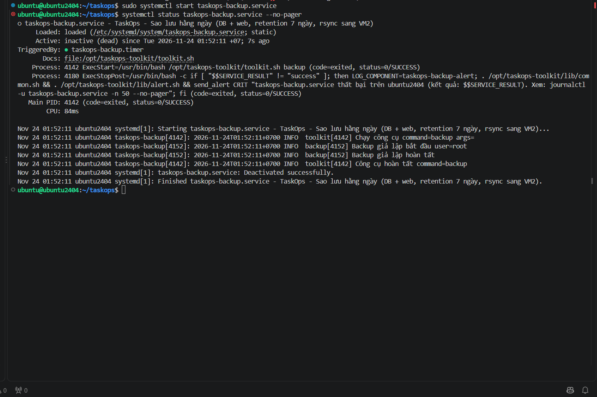
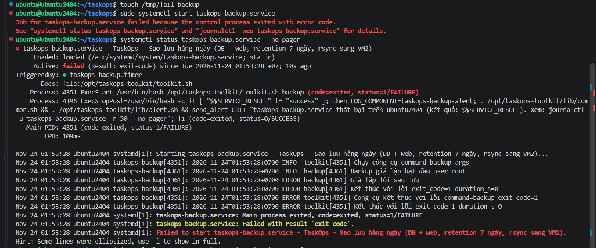
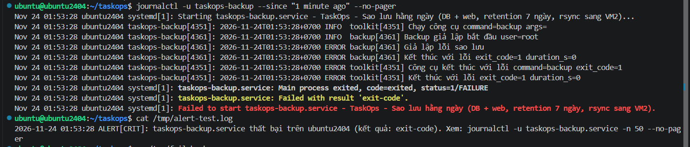

# F15: systemd service và timer sao lưu hằng ngày

Người thực hiện: Nguyễn Tấn Vinh  ·  Ngày: 22/11/2026

Mã nguồn: `toolkit/systemd/taskops-backup.service`, `toolkit/systemd/taskops-backup.timer` (đúng tên và vị trí trong `toolkit/README.md`)
Môi trường: Ubuntu 24.04, múi giờ `Asia/Ho_Chi_Minh`.

## Tại sao cần
Đề bài yêu cầu sao lưu tự động theo lịch (cron hoặc systemd timer) và ghi lại lịch trong báo cáo. Dùng systemd timer thay vì cron vì:
- Có `Persistent=true`: nếu VM tắt đúng 02:00 thì khi bật lại sẽ chạy bù; cron không làm được.
- Log vào journald (`journalctl -u taskops-backup`), xem trạng thái bằng `systemctl`, không phải tìm file log rải rác.
- Có thể gửi cảnh báo khi sao lưu thất bại (`ExecStopPost`) và dùng `RequiresMountsFor=` để không ghi nhầm vào đĩa hệ thống nếu đĩa `/srv/backup` chưa mount.

## Đã làm
- `taskops-backup.service` (`Type=oneshot`): chạy `toolkit.sh backup` bằng root; `Nice=10` và `IOSchedulingClass=idle` để không làm chậm web; `TimeoutStartSec=2h`; log ra journald và `/var/log/taskops/toolkit.log`.
- `ExecStopPost=`: chạy sau khi service kết thúc; nếu `$SERVICE_RESULT` khác `success` (script thoát khác 0, quá thời gian...) thì nạp `lib/common.sh` và `lib/alert.sh` rồi gọi `send_alert CRIT "<nội dung lỗi>"`. Hàm này (F13) gửi qua Telegram hoặc msmtp và luôn trả về 0. Dấu `-` ở đầu để lỗi khi gửi cảnh báo không đổi kết quả của service.
- `taskops-backup.timer`: `OnCalendar=*-*-* 02:00:00`, `Persistent=true`, `AccuracySec=1s`.
- Retention 7 ngày do `bin/backup.sh` thực hiện (xóa archive cũ hơn 7 ngày sau mỗi lần sao lưu).

## Cách cài và kiểm chứng
```
# Dev: liên kết repo vào đường dẫn các unit dùng
sudo ln -s ~/taskops/toolkit /opt/taskops-toolkit

# Cài
sudo install -m 0644 toolkit/systemd/taskops-backup.service toolkit/systemd/taskops-backup.timer /etc/systemd/system/
systemd-analyze verify /etc/systemd/system/taskops-backup.service /etc/systemd/system/taskops-backup.timer
sudo systemctl daemon-reload
sudo systemctl enable --now taskops-backup.timer

# Lịch
systemctl list-timers taskops-backup.timer --no-pager
systemctl cat taskops-backup.timer --no-pager
systemd-analyze calendar "*-*-* 02:00:00"

# Chạy tay một lần và xem log
sudo systemctl start taskops-backup.service
systemctl status taskops-backup.service --no-pager
journalctl -u taskops-backup -n 20 --no-pager
tail -5 /var/log/taskops/toolkit.log

# Mô phỏng lỗi để kích hoạt cảnh báo (dùng bin/backup.sh giả có kiểm tra file /tmp/fail-backup)
touch /tmp/fail-backup
sudo systemctl start taskops-backup.service
systemctl status taskops-backup.service --no-pager
cat /tmp/alert-test.log
rm /tmp/fail-backup

# Gỡ
sudo systemctl disable --now taskops-backup.timer
sudo rm /etc/systemd/system/taskops-backup.service /etc/systemd/system/taskops-backup.timer
sudo systemctl daemon-reload
```

## Bằng chứng

Timer đã bật, lần chạy kế tiếp là 02:00 ngày hôm sau:


Nội dung timer và các lần chạy kế tiếp của lịch `*-*-* 02:00:00`:


Chạy tay một lần thành công (`status=0/SUCCESS`, log vào journald và file `toolkit.log`):




Mô phỏng lỗi. Service thất bại và `ExecStopPost` chạy:



Log của lần lỗi và cảnh báo đã được ghi lại:



Lưu ý: kiểm thử dùng `bin/backup.sh` giả lập và `lib/alert.sh` giả lập (hàm `send_alert` ghi vào `/tmp/alert-test.log`) đặt tạm; sẽ chạy lại với bản thật khi các file này có trong `main`.

## Lịch chạy ghi trong báo cáo
| Mục | Giá trị |
|---|---|
| Công cụ | systemd timer `taskops-backup.timer` |
| Thời điểm | 02:00 mỗi ngày (múi giờ VM) |
| Chạy bù khi VM tắt | Có (`Persistent=true`) |
| Retention | 7 ngày (trong `bin/backup.sh`) |
| Cảnh báo khi lỗi | `ExecStopPost=` gọi `send_alert CRIT "..."` (lib/alert.sh) khi `$SERVICE_RESULT` khác `success` |
