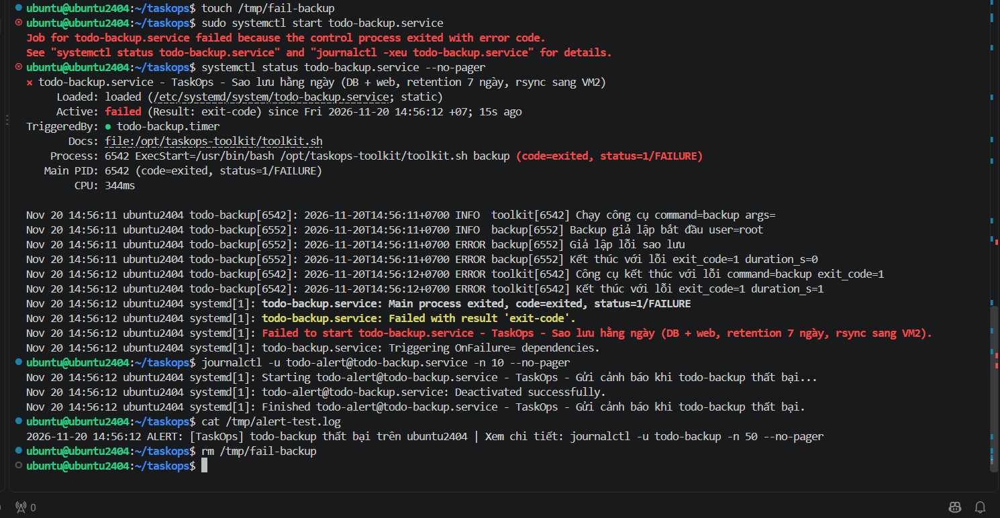

# F15: systemd service và timer sao lưu hằng ngày

Người thực hiện: Nguyễn Tấn Vinh  ·  Ngày: 20/11/2026

Mã nguồn: `toolkit/systemd/` (`todo-backup.service`, `todo-backup.timer`, `todo-alert@.service`, `install-timer.sh`)
Môi trường: Ubuntu 24.04, múi giờ `Asia/Ho_Chi_Minh`.

## Tại sao cần
Đề bài yêu cầu sao lưu tự động theo lịch (cron hoặc systemd timer) và ghi lại lịch trong báo cáo. Dùng systemd timer thay vì cron vì:
- Có `Persistent=true`: nếu VM tắt đúng 02:00 thì khi bật lại sẽ chạy bù, cron không làm được.
- Log vào journald (`journalctl -u todo-backup`), xem trạng thái bằng `systemctl`, không phải tìm file log rải rác.
- Có `OnFailure=` để gửi cảnh báo khi sao lưu thất bại và `RequiresMountsFor=` để không ghi nhầm vào đĩa hệ thống nếu đĩa `/srv/backup` chưa mount.

## Đã làm
- `todo-backup.service` (`Type=oneshot`): chạy `toolkit.sh backup` bằng root; `Nice=10` và `IOSchedulingClass=idle` để không làm chậm web; `TimeoutStartSec=2h`; log ra journald và `/var/log/taskops/toolkit.log`.
- `todo-backup.timer`: `OnCalendar=*-*-* 02:00:00`, `Persistent=true`, `AccuracySec=1s`.
- `todo-alert@.service`: unit mẫu gửi cảnh báo qua `alert.sh`; `todo-backup.service` gắn vào bằng `OnFailure=todo-alert@%N.service`.
- `install-timer.sh`: kiểm tra unit bằng `systemd-analyze verify`, chép vào `/etc/systemd/system`, `daemon-reload`, bật timer. Có `-n` (chạy thử), `-d` (thư mục cài), `-u` (gỡ), `--help`; dùng chung `lib/` của toolkit.
- Retention 7 ngày do `backup.sh` thực hiện (xóa archive cũ hơn 7 ngày sau mỗi lần sao lưu).

## Cách kiểm chứng
```
# 1. Cài (dev: tạo liên kết tới repo)
sudo ln -s ~/taskops/toolkit /opt/taskops-toolkit
sudo ./toolkit/systemd/install-timer.sh -n          # chạy thử
sudo ./toolkit/systemd/install-timer.sh             # cài thật

# 2. Lịch
systemctl list-timers todo-backup.timer --no-pager
systemd-analyze calendar "*-*-* 02:00:00"           # xem các lần chạy kế tiếp

# 3. Chạy tay một lần và xem log
sudo systemctl start todo-backup.service
systemctl status todo-backup.service --no-pager
journalctl -u todo-backup -n 30 --no-pager
tail -5 /var/log/taskops/toolkit.log
ls -l /srv/backup

# 4. Mô phỏng lỗi để kích hoạt cảnh báo
sudo systemctl stop postgresql
sudo systemctl start todo-backup.service            # backup.sh báo PostgreSQL không sẵn sàng
journalctl -u todo-alert@todo-backup.service -n 20 --no-pager
sudo systemctl start postgresql
```

## Bằng chứng
Lịch sao lưu 02:00 (timer đã bật, lần chạy kế tiếp là 02:00 ngày hôm sau):


Chạy tay một lần thành công (status=0/SUCCESS, log vào journald và file toolkit.log):


Mô phỏng lỗi: service thất bại, OnFailure kích hoạt unit cảnh báo, cảnh báo được ghi lại:



## Lịch chạy ghi trong báo cáo
| Mục | Giá trị |
|---|---|
| Công cụ | systemd timer `todo-backup.timer` |
| Thời điểm | 02:00 mỗi ngày (múi giờ VM) |
| Chạy bù khi VM tắt | Có (`Persistent=true`) |
| Retention | 7 ngày (trong `backup.sh`) |
| Cảnh báo khi lỗi | `OnFailure=todo-alert@%N.service` gọi `alert.sh` |
