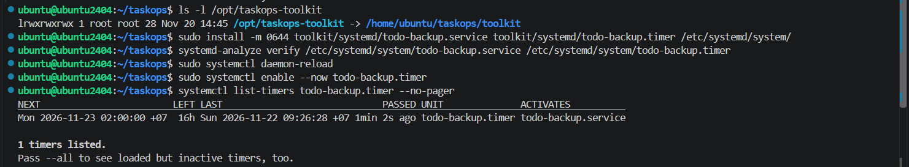
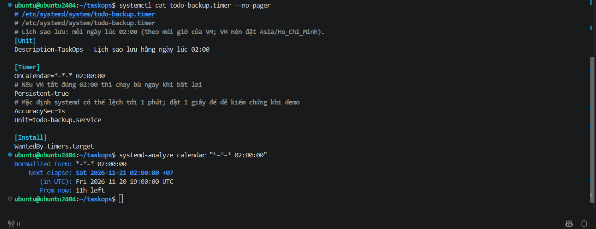
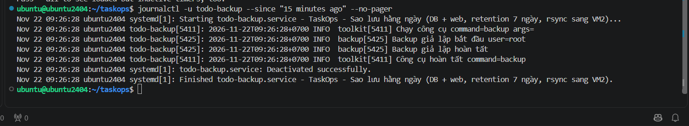

# F15: systemd service và timer sao lưu hằng ngày

Người thực hiện: Nguyễn Tấn Vinh  ·  Ngày: 20/11/2026

Mã nguồn: `toolkit/systemd/todo-backup.service`, `toolkit/systemd/todo-backup.timer`
Môi trường: Ubuntu 24.04, múi giờ `Asia/Ho_Chi_Minh`.

## Tại sao cần
Đề bài yêu cầu sao lưu tự động theo lịch (cron hoặc systemd timer) và ghi lại lịch trong báo cáo. Dùng systemd timer thay vì cron vì:
- Có `Persistent=true`: nếu VM tắt đúng 02:00 thì khi bật lại sẽ chạy bù; cron không làm được.
- Log vào journald (`journalctl -u todo-backup`), xem trạng thái bằng `systemctl`, không phải tìm file log rải rác.
- Có thể gửi cảnh báo khi sao lưu thất bại (`ExecStopPost`) và dùng `RequiresMountsFor=` để không ghi nhầm vào đĩa hệ thống nếu đĩa `/srv/backup` chưa mount.

## Đã làm
- `todo-backup.service` (`Type=oneshot`): chạy `toolkit.sh backup` bằng root; `Nice=10` và `IOSchedulingClass=idle` để không làm chậm web; `TimeoutStartSec=2h`; log ra journald và `/var/log/taskops/toolkit.log`.
- `ExecStopPost=`: chạy sau khi service kết thúc; nếu `$SERVICE_RESULT` khác `success` (script thoát khác 0, quá thời gian...) thì gọi `alert.sh` với tiêu đề và nội dung lỗi. Dấu `-` ở đầu để lỗi của `alert.sh` không đổi kết quả của service.
- `todo-backup.timer`: `OnCalendar=*-*-* 02:00:00`, `Persistent=true`, `AccuracySec=1s`.
- Retention 7 ngày do `backup.sh` thực hiện (xóa archive cũ hơn 7 ngày sau mỗi lần sao lưu).
- Cấu trúc thư mục theo README: `toolkit/systemd/` chỉ có hai file trên; `backup.sh` và `alert.sh` nằm trong `toolkit/`.

## Cách cài và kiểm chứng
```
# Dev: liên kết repo vào đường dẫn các unit dùng
sudo ln -s ~/taskops/toolkit /opt/taskops-toolkit

# Cài
sudo install -m 0644 toolkit/systemd/todo-backup.service toolkit/systemd/todo-backup.timer /etc/systemd/system/
systemd-analyze verify /etc/systemd/system/todo-backup.service /etc/systemd/system/todo-backup.timer
sudo systemctl daemon-reload
sudo systemctl enable --now todo-backup.timer

# Lịch
systemctl list-timers todo-backup.timer --no-pager
systemctl cat todo-backup.timer --no-pager
systemd-analyze calendar "*-*-* 02:00:00"

# Chạy tay một lần và xem log
sudo systemctl start todo-backup.service
systemctl status todo-backup.service --no-pager
journalctl -u todo-backup -n 20 --no-pager
tail -5 /var/log/taskops/toolkit.log

# Mô phỏng lỗi để kích hoạt cảnh báo (dùng backup.sh giả có kiểm tra file /tmp/fail-backup)
touch /tmp/fail-backup
sudo systemctl start todo-backup.service
systemctl status todo-backup.service --no-pager
cat /tmp/alert-test.log
rm /tmp/fail-backup

# Gỡ
sudo systemctl disable --now todo-backup.timer
sudo rm /etc/systemd/system/todo-backup.service /etc/systemd/system/todo-backup.timer
sudo systemctl daemon-reload
```

## Bằng chứng

Timer đã bật, lần chạy kế tiếp là 02:00 ngày hôm sau:



Nội dung timer và các lần chạy kế tiếp của lịch `*-*-* 02:00:00`:



Chạy tay một lần thành công (`status=0/SUCCESS`, log vào journald và file `toolkit.log`):


Mô phỏng lỗi: service thất bại (`failed`), `ExecStopPost` gọi `alert.sh` và cảnh báo được ghi lại:


Bật timer khi đã lỡ lịch 02:00 của các ngày trước: nhờ `Persistent=true`, systemd chạy bù ngay một lần (dòng 09:26:28 trong log), đúng như thiết kế:



Lưu ý: kiểm thử dùng `backup.sh` và `alert.sh` giả lập đặt tạm trong `toolkit/`; sẽ chạy lại với bản thật khi các script này có trong repo.

## Lịch chạy ghi trong báo cáo
| Mục | Giá trị |
|---|---|
| Công cụ | systemd timer `todo-backup.timer` |
| Thời điểm | 02:00 mỗi ngày (múi giờ VM) |
| Chạy bù khi VM tắt | Có (`Persistent=true`) |
| Retention | 7 ngày (trong `backup.sh`) |
| Cảnh báo khi lỗi | `ExecStopPost=` gọi `alert.sh` khi `$SERVICE_RESULT` khác `success` |
